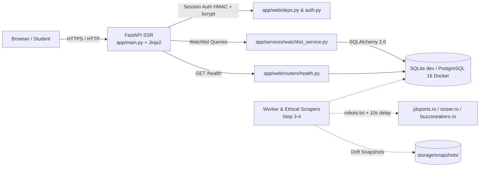

# P23 · Ethical Sneaker Price Monitor

> Proiect realizat în cadrul activităților de laborator ULBS (Ingineria Programării / Tehnologii Web — Categoria E: Integrări & fișiere).

Sistem web de monitorizare etică a prețurilor și disponibilității pentru încălțăminte sport (*sneakers*) pe 3 retaileri din România (`jdsports.ro`, `sizeer.ro`, `buzzsneakers.ro`), cu deduplicare după SKU, istoric de prețuri, autentificare server-side cu roluri (`user` / `admin`), detecție de derivă (*drift detection*) și pregătire pentru alertare Email & Telegram.

---

## Build Status (Checkpoint · Step 2)

- **Foundation (Step 1):** SQLAlchemy 2.0 schema (8 modele), hashing `bcrypt`, seed idempotent, 24 teste pytest — **complet**.
- **Web Core & Infrastructure (Step 2):** FastAPI SSR (`DS-01` `/login`, `DS-02` `/` & `/watchlist`), `GET /health`, sesiuni HMAC-SHA256 `HttpOnly`, PostgreSQL 16 + SQLite, Docker Compose, GitHub Actions CI, `API.md` & `CONTRACTS.md` — **implementat pe `feat/step-2-web-checkpoint`**.
- **Urmează:** Adaptoare etice & `robots.txt` (Step 3), Drift Detection & Admin `DS-05` (Step 4), Chart.js `DS-03` & notificări Email/Telegram `DS-04` (Step 5). Vezi [TODO.md](file:///home/manol/Work/ULBS_laborator/TODO.md).

---

## 5-Minute Quickstart (`docker compose up`)

1. **Copiază configurația de mediu:**
   ```bash
   cp .env.example .env
   ```
2. **Pornește PostgreSQL 16 + FastAPI (`web` pe portul `8000`):**
   ```bash
   docker compose up --build
   ```
   Serviciul `db` (`postgres:16-alpine`) așteaptă `pg_isready`, apoi `web` rulează automat `python -m app.db.seed` și pornește `uvicorn` pe `http://localhost:8000`.
3. **Verifică sănătatea și autentifică-te:**
   - Health check: `curl http://localhost:8000/health` → `{"status":"ok","database":"ok"}`
   - UI Watchlist: deschide `http://localhost:8000/login`
   - Conturi seed (în `development`):
     - Utilizator demo: `user@pricemonitor.local` / `User123!` (sau valorile din `.env`)
     - Administrator: `admin@pricemonitor.local` / `Admin123!`

### Rulare locală (SQLite + pytest)

```bash
python3 -m venv .venv
source .venv/bin/activate
pip install -r requirements.txt
python3 -m app.db.seed
uvicorn app.main:app --reload --port 8000
```

Verificări automate:
```bash
pytest -v
python3 docs/agents/tools/ledger-lint.py
```

---

## Variabile de Mediu (`.env.example`)

| Variabilă | Valoare implicită (dev) | Rol |
|---|---|---|
| `ENVIRONMENT` | `development` | `production` impune `SECRET_KEY` explicit și cookie `Secure` |
| `APP_NAME` | `P23 Ethical Sneaker Price Monitor` | Titlul aplicației FastAPI |
| `DATABASE_URL` | `sqlite:///./data/pricemonitor.db` | SQLite local sau `postgresql+psycopg://user:pass@db:5432/pricemonitor` |
| `POSTGRES_DB` / `POSTGRES_USER` / `POSTGRES_PASSWORD` | `pricemonitor` | Credențiale container PostgreSQL 16 (`docker-compose.yml`) |
| `SECRET_KEY` | `dev-only-change-before-production` | Cheie HMAC-SHA256 pentru semnarea cookie-urilor de sesiune |
| `SESSION_COOKIE_NAME` | `p23_session` | Numele cookie-ului `HttpOnly` de sesiune |
| `SESSION_MAX_AGE_SECONDS` | `604800` | Durata de viață a sesiunii (7 zile) |
| `DEFAULT_POLLING_INTERVAL_MINUTES` | `360` | Interval implicit de verificare (6 ore, conform `D-002`) |
| `DEFAULT_MIN_DELAY_SECONDS` | `10` | Pauză minimă între cereri către același domeniu (`>= 10s`) |
| `DEFAULT_MAX_REQUESTS_PER_HOUR` | `30` | Limită maximă cereri/oră per domeniu (`<= 30`) |
| `ROBOTS_CACHE_TTL_HOURS` | `24` | TTL cache local pentru `robots.txt` |
| `SEED_ADMIN_EMAIL` / `SEED_ADMIN_PASSWORD` | `admin@pricemonitor.local` / `Admin123!` | Cont administrator inițial |
| `SEED_USER_EMAIL` / `SEED_USER_PASSWORD` | `user@pricemonitor.local` / `User123!` | Cont utilizator demo cu watchlist preîncărcat |
| `TELEGRAM_BOT_TOKEN`, `SMTP_*` | *(opțional)* | Canale externe pentru alerte (Email & Telegram) |

---

## Variabile Personale & Fundamentare (`INTERVIEW.md` & `ETHICS.md`)

- **Validare nevoi ([INTERVIEW.md](file:///home/manol/Work/ULBS_laborator/INTERVIEW.md), 7 respondenți, 16.11.2026):**
  - **Categorie țintă:** Încălțăminte / articole sportive (*sneakers*, aleasă de **71,4%** dintre respondenți).
  - **Frecvență polling:** **6 ore** (4 verificări/zi, acoperă nevoile celor **57,2%** care verifică zilnic prețurile).
  - **Praguri de alertă:** scădere sub prag fix (**57,1%**), reducere $\ge 15\text{--}20\%$ (**57,1%**), revenire în stoc (**28,6%**).
  - **Canale preferate:** Email (**100%**), Email + Telegram (**14,3%**), grafic istoric (**85,7%**).
- **Politică etică și legalitate ([ETHICS.md](file:///home/manol/Work/ULBS_laborator/ETHICS.md), 18.11.2026):**
  - **Magazine aprobate (3):** `jdsports.ro`, `sizeer.ro`, `buzzsneakers.ro` (pagini individuale de produs permise în `robots.txt`; rute `/search*`, `/cos/*`, `/login` excluse).
  - **Magazine respinse:** `zara.com` (ToS anti-scraping + WAF), `fashiondays.ro` (`robots.txt` redirect HTML), `epantofi.ro` (`robots.txt` 404 + anti-bot).
  - **Politețe:** `User-Agent` transparent `ULBS-Web2-PriceMonitor/1.0 (+https://github.com/m-alex123/ULBS_laborator)`, `delay >= 10s`, `<= 30 req/h`, cache `robots.txt` la `24h`.

---

## Arhitectura Sistemului



## Documentație Suplimentară

- [API.md](file:///home/manol/Work/ULBS_laborator/API.md) — Specificația rutelor `/health`, `/login`, `/logout`, `/watchlist`, `/admin/status`
- [docs/scope.md](file:///home/manol/Work/ULBS_laborator/docs/scope.md) — Domeniul de aplicare și cerințele funcționale P23
- [docs/agents/DECISIONS.md](file:///home/manol/Work/ULBS_laborator/docs/agents/DECISIONS.md) — Decizii arhitecturale (`D-001`..`D-004`)
- [docs/agents/CONTRACTS.md](file:///home/manol/Work/ULBS_laborator/docs/agents/CONTRACTS.md) — Contracte furnizate (`C-001`..`C-003`)
- [docs/agents/ARCHITECTURE.md](file:///home/manol/Work/ULBS_laborator/docs/agents/ARCHITECTURE.md) — Structura codului și stocarea datelor
